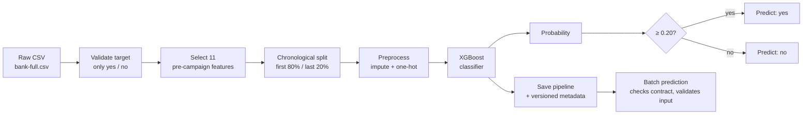

# XGBoost Bank Marketing

[](https://github.com/JiaHui2005/xgboost-bank-marketing/actions/workflows/tests.yml)

Predicts, **before a marketing campaign starts**, which bank clients are most likely to subscribe to a term deposit, using the UCI Bank Marketing dataset. The focus is on doing the ML engineering honestly: a feature contract that matches the prediction point, chronological validation with no test-set reuse, a versioned model artifact checked at inference time, and tests that run in CI.

**Key findings**

- Once features that are only known during or after the call (`duration`, `campaign`, `contact`, `day`, `month`) are removed, the remaining signal is weak: ROC-AUC is about 0.69 on the 80/20 validation split and 0.53–0.66 across five time windows.
- Results depend heavily on the period evaluated, because the subscription rate rises from about 5% to 36% across the dataset.
- XGBoost does **not** beat a Logistic Regression baseline on these features. Both are kept so the comparison stays visible.
- This is a predictive model, not a causal one, and no independent holdout exists yet. See [Limitations](#limitations-and-future-improvements).

## Table of Contents

- [Problem Definition](#problem-definition)
- [Dataset](#dataset)
- [Pipeline](#pipeline)
- [Evaluation Strategy](#evaluation-strategy)
- [Results](#results)
- [Quick Start](#quick-start)
- [Training and Experiments](#training-and-experiments)
- [Batch Prediction](#batch-prediction)
- [Model Artifact](#model-artifact)
- [Testing and CI](#testing-and-ci)
- [Project Structure](#project-structure)
- [Limitations and Future Improvements](#limitations-and-future-improvements)
- [License](#license)

## Problem Definition

| | |
| --- | --- |
| **Task** | Binary classification: will the client subscribe to a term deposit (`y = yes`)? |
| **Prediction point** | Before the current marketing campaign begins, when the bank decides whom to contact. |
| **Use** | Rank clients so a limited contact capacity is spent on the most likely subscribers. |
| **Output** | A subscription probability per client, plus a `yes`/`no` label at a fixed threshold of `0.20`. |
| **Out of scope** | Estimating the causal effect of a call, or choosing a business-optimal threshold (FP/FN costs and contact capacity have not been provided). |

Because the decision is made before any contact, only information available at that moment may be used as features. This rule drives the feature contract below.

## Dataset

[Bank Marketing](https://archive.ics.uci.edu/dataset/222/bank+marketing) from the UCI Machine Learning Repository: `bank-full.csv`, 45,211 rows, 17 columns, semicolon-delimited, target `y` (`yes`/`no`). UCI documents the rows as ordered by date (May 2008 to November 2010).

The raw dataset is not committed. Download it and place it at `data/raw/bank-full.csv` before training or running experiments. Unit tests and batch prediction do not need it.

### Feature Contract

The model uses 11 pre-campaign features, defined once in `src/feature_contract.py`. The UCI dictionary describes fields but does not prove when a production system exposes them; operations confirmed on 2026-10-29 that `pdays`, `previous`, and `poutcome` are available before the current campaign. Profile-field freshness still needs confirmation before deployment.

| Feature | UCI meaning | Available before the campaign? | Missing / special values | Decision |
| --- | --- | --- | --- | --- |
| `age` | Client age | Assumed; confirm source freshness | Numeric nulls use the training median | Keep |
| `job` | Job type | Assumed; confirm source freshness | `unknown` kept as a category; nulls use `__missing__` | Keep |
| `marital` | Marital status (`divorced` includes widowed) | Assumed; confirm source freshness | `unknown` kept as a category; nulls use `__missing__` | Keep |
| `education` | Education level | Assumed; confirm source freshness | `unknown` kept as a category; nulls use `__missing__` | Keep |
| `default` | Has credit in default | Assumed; confirm source freshness | Nulls use `__missing__` | Keep |
| `balance` | Average yearly balance (EUR) | Assumed; confirm source freshness | Numeric nulls use the training median | Keep |
| `housing` | Has a housing loan | Assumed; confirm source freshness | Nulls use `__missing__` | Keep |
| `loan` | Has a personal loan | Assumed; confirm source freshness | Nulls use `__missing__` | Keep |
| `pdays` | Days since last contact in a previous campaign | Yes, confirmed 2026-10-29 | `-1` = never contacted (a value, not missing) | Keep |
| `previous` | Contacts before this campaign | Yes, confirmed 2026-10-29 | `0` = no prior contacts | Keep |
| `poutcome` | Outcome of the previous campaign | Yes, confirmed 2026-10-29 | `unknown` kept as a category | Keep |
| `duration` | Last call duration | No, known only after the call | | **Drop** |
| `campaign` | Contacts during this campaign | No, counts current-campaign contacts | | **Drop** |
| `contact`, `day`, `month` | Channel and date of the current contact | No, attributes of the current contact | | **Drop** |

`duration` is the classic leakage trap in this dataset: it is highly predictive but unknown until the call has ended.

### No Prior Contact vs. Missing Data

These are treated as different states on purpose:

- **No prior contact** is a known fact, encoded by the values themselves: `pdays = -1` and `previous = 0`. They always occur together in `bank-full.csv` (36,954 of 45,211 rows, 81.7%), and all of these rows have `poutcome = unknown`. The model receives these values unchanged; tree models can split on `pdays = -1` without an extra indicator column.
- `poutcome = unknown` alone does not prove the client was never contacted: 5 rows have prior contacts but an `unknown` outcome. Use `pdays`/`previous` to identify clients with no history.
- **Missing data** (`NaN`, `None`, `pd.NA`, a blank CSV field) means the value was not supplied. It is imputed (median for numeric, `__missing__` for categorical) and never interpreted as "no prior contact". Upstream systems should send `-1`/`0`/`unknown` for clients with no history rather than leaving fields blank.

The UCI data itself contains no missing values; the imputation policy covers new input data.

## Pipeline



- Preprocessing and the classifier are one scikit-learn `Pipeline`, so training and inference apply identical transformations, and imputation statistics are fitted on training rows only.
- Numeric features: median imputation. Categorical features: a `__missing__` category, then one-hot encoding that ignores categories unseen during training.
- XGBoost settings: `n_estimators=300`, `learning_rate=0.05`, `max_depth=4`, `min_child_weight=5`, `subsample=0.8`, `colsample_bytree=0.8`, `random_state=42`. These, the `0.20` threshold, the 80% train fraction, and all file paths live in one place, `src/config.py`; every script imports them from there. Training twice with the same seed gives identical predictions (covered by a test).
- `models/metadata.json` records the feature list, dropped features, threshold, target mapping, seed, split, Python and dependency versions, training time, and validation metrics. Batch prediction refuses an artifact whose metadata or pipeline columns do not match the current feature contract.

## Evaluation Strategy

**Split.** Rows keep their UCI (date) order with no shuffling or stratification: the first 80% train, the last 20% validate. This mimics training on the past and predicting a later period.

**No test-set reuse.** An earlier version of this project compared models on a test set, which exposed that set to model selection. Those numbers are withdrawn. Validation is used for development only. An independent estimate requires new campaign data, evaluated once after the model and threshold are locked. No holdout is carved out of `bank-full.csv`.

**Metrics.** The target is imbalanced and the use case is ranking, so:

- **Average Precision (AP)** is the primary ranking metric. A random model's AP equals the positive rate, so always read AP next to it.
- **ROC-AUC** is secondary.
- At the fixed `0.20` threshold the scripts also report precision, recall, F1, FPR (`FP / (FP + TN)`), FNR (`FN / (FN + TP)`), confusion counts, and class support. These describe trade-offs; `0.20` is not claimed to be optimal.
- Accuracy alone is not used.

**Stability.** A single split gives one point estimate, so both models are also retrained on 5 expanding time windows (`TimeSeriesSplit`).

## Results

All numbers are development validation, not an independent holdout.

### Chronological 80/20 Split

Validation: 9,043 rows, 2,856 positives (31.6%).

| Model | AP | ROC-AUC | Precision @0.20 | Recall @0.20 | F1 @0.20 | FPR @0.20 |
| --- | --- | --- | --- | --- | --- | --- |
| XGBoost | 0.484 | 0.694 | 0.506 | 0.388 | 0.439 | 0.174 |
| Logistic Regression | **0.548** | **0.718** | 0.685 | 0.315 | 0.431 | 0.067 |

### Stability Across Time Windows

Each window trains on all earlier rows and validates on the next 7,535 rows. Hyperparameters and the `0.20` threshold are not tuned per window.

| Window | Train rows | Positive rate | XGBoost AP | LogReg AP | XGBoost ROC-AUC | LogReg ROC-AUC | XGBoost recall @0.20 |
| --- | --- | --- | --- | --- | --- | --- | --- |
| 1 | 7,536 | 5.2% | 0.060 | 0.067 | 0.534 | 0.567 | 0.003 |
| 2 | 15,071 | 6.2% | 0.069 | 0.079 | 0.528 | 0.553 | 0.000 |
| 3 | 22,606 | 5.9% | 0.072 | 0.057 | 0.555 | 0.505 | 0.002 |
| 4 | 30,141 | 13.6% | 0.232 | 0.250 | 0.658 | 0.663 | 0.008 |
| 5 | 37,676 | 36.3% | 0.501 | 0.564 | 0.659 | 0.688 | 0.407 |
| **Mean ± std** | | | **0.187 ± 0.190** | **0.203 ± 0.217** | **0.587 ± 0.067** | **0.595 ± 0.077** | **0.084 ± 0.181** |

What this shows:

- **Results are period-dependent.** AP largely tracks each window's positive rate, so compare AP with that rate, not across windows.
- **Ranking ability is weak with pre-campaign features.** ROC-AUC is 0.53–0.56 in the first three windows.
- **The fixed `0.20` threshold does not transfer across periods.** Models trained on low-base-rate periods rarely exceed it, so recall is near zero in windows 1–4.
- **XGBoost does not consistently beat Logistic Regression.** The baseline has equal or higher mean AP and ROC-AUC, and differences are within the spread across windows.

The 80/20 result is therefore one period's estimate, not a stable performance level. The checked-in artifact is still the XGBoost pipeline; switching models, calibrating probabilities, or choosing a threshold should wait for business inputs (contact capacity, FP/FN costs) and an independent holdout.

## Quick Start

Requires Python 3.12+ and [uv](https://docs.astral.sh/uv/).

```bash
git clone https://github.com/JiaHui2005/xgboost-bank-marketing.git
```

```bash
cd xgboost-bank-marketing
```

```bash
uv sync
```

Score the bundled sample of 5 synthetic clients with the checked-in model (no dataset download needed):

```bash
uv run python scripts/predict.py --input examples/sample_customers.csv
```

Expected output (probabilities may differ slightly across platforms):

```text
 subscription_probability prediction_label
                 0.076445               no
                 0.784054              yes
                 0.189532               no
                 0.017961               no
                 0.073595               no
```

Client `C002` has a previous successful campaign (`poutcome = success`) and scores highest. `C005` has blank `education` and `balance`, which the pipeline imputes.

Predictions are written to `data/processed/predictions.csv`. Running the command again stops with an error rather than replacing that file; add `--overwrite` or pass a different `--output`.

## Training and Experiments

These commands need `data/raw/bank-full.csv`. Paths are resolved from the repository root, so they work from any directory.

Every training and evaluation script runs a data check (`check_training_data` in `src/data_loader.py`) before splitting. It stops on missing columns, non-numeric or out-of-range values (`age` outside 0–120, `pdays` not `-1` or ≥ 0, negative `previous`), a feature that is entirely missing, invalid labels, or a single target class. It prints row count, positive rate, missing rate per column, and duplicate rows. `bank-full.csv` passes with 45,211 rows, an 11.7% positive rate, no missing values, and 1,194 rows that repeat another row's features and label; without a client ID these cannot be confirmed as true duplicates, so they are reported rather than removed.

| Command | What it does | Output |
| --- | --- | --- |
| `uv run python scripts/train_model.py` | Trains XGBoost on the 80/20 split, prints validation metrics, saves the artifact | `models/xgboost_pipeline.joblib`, `models/metadata.json` |
| `uv run python scripts/compare_models.py` | XGBoost vs. Logistic Regression on the 80/20 split | `data/processed/model_comparison.csv` |
| `uv run python scripts/evaluate_time_windows.py` | Both models across 5 expanding time windows | `data/processed/time_window_metrics.csv`, `data/processed/time_window_summary.csv` |
| `uv run python scripts/optimize_threshold.py` | Threshold trade-off table on validation (descriptive; does not change the threshold) | `data/processed/threshold_comparison.csv` |

`analyze_prediction_errors.py` and `analyze_group_error_rates.py` break validation errors down by feature value at the same `0.20` threshold. Groups with fewer than 30 actual positives or negatives are marked `low_support`, since their rates are too noisy to compare (for example `job = unknown`, with 17 positives). Group differences are descriptive and are not a fairness or causal analysis.

`train_model.py` overwrites the checked-in model artifact. Retrain after changing the feature contract or training settings, since batch prediction rejects a mismatched artifact.

## Batch Prediction

```bash
uv run python scripts/predict.py --input path/to/clients.csv --output path/to/predictions.csv
```

| Option | Default | Meaning |
| --- | --- | --- |
| `--input` | required | Semicolon-delimited CSV to score |
| `--output` | `data/processed/predictions.csv` | Where to write predictions |
| `--overwrite` | off | Allow replacing an existing output file |

The command never writes over its own input file, and refuses to replace an existing output unless `--overwrite` is given. Input problems are reported as a single `Error: ...` line that names the file or column and what to change, instead of a Python traceback.

**Input.** A semicolon-delimited CSV containing the 11 contract features. Other columns (for example a client ID) are allowed and copied to the output; `duration`, `campaign`, `contact`, `day`, and `month` are not required. Missing values are accepted and imputed. The command rejects an empty file, missing or duplicate columns, infinite or non-numeric values (including `True`/`False`) in numeric columns, and non-text values in categorical columns.

**Output.** A semicolon-delimited CSV with the input columns plus:

| Column | Description |
| --- | --- |
| `subscription_probability` | Predicted probability of subscribing |
| `prediction` | `1` if probability ≥ threshold, else `0` |
| `prediction_label` | `yes` or `no` |

The threshold (`0.20`) is read from `models/metadata.json`, not hard-coded in the prediction logic.

## Model Artifact

The fitted pipeline is committed to Git so the project runs right after cloning, without the dataset. At 437 KB it does not need Git LFS or a separate release.

| File | Size | SHA-256 |
| --- | --- | --- |
| `models/xgboost_pipeline.joblib` | 447,363 bytes | `23d042a55f47860e1a9a61b65ca4c19c33ffb3f3f4b80cd3a00efd7a5452a45f` |
| `models/metadata.json` | 1,456 bytes | `60236bb5323378d5ccc8ae212046365b327e5161fad6d6981683345f5bd77ee6` |

Verify a download with:

```bash
shasum -a 256 models/xgboost_pipeline.joblib models/metadata.json
```

A joblib file is only guaranteed to load with the library versions it was saved with; those are recorded in `metadata.json` under `dependency_versions` and pinned by `uv.lock`. Only load artifacts from a trusted source, since unpickling can run code. To regenerate the artifact, place the dataset and run `uv run python scripts/train_model.py`, then update the checksums above (the training timestamp in metadata changes on every run).

## Testing and CI

```bash
uv run ruff check .
```

```bash
uv run ruff format --check .
```

```bash
uv run pytest -q
```

Tests cover target validation, training-data checks, config and training determinism, CLI behaviour (output overwrite guard, error messages), the feature contract, the chronological split (including that no test set is scored), preprocessing and imputation edge cases (`NaN`, `pd.NA`, nullable dtypes, all-missing columns), input validation, metric arithmetic (FPR/FNR, undefined groups), artifact and metadata compatibility, time-window evaluation, and inference with the saved model. They need neither the raw dataset nor network access.

Code is formatted with `ruff format` and linted with ruff using the rule set pinned in `pyproject.toml` (pyflakes and core pycodestyle errors, whitespace, import order, bugbear). GitHub Actions (`.github/workflows/tests.yml`) installs dependencies from `uv.lock`, then runs the lint check, the format check and the test suite on every push to `main` and on pull requests.

## Project Structure

```text
xgboost-bank-marketing/
├── .github/workflows/tests.yml   # CI: pytest on a clean install
├── data/
│   ├── raw/                      # bank-full.csv (not committed)
│   └── processed/                # script outputs and predictions (not committed)
├── examples/
│   └── sample_customers.csv      # 5 synthetic clients for a quick demo
├── models/
│   ├── xgboost_pipeline.joblib   # fitted preprocessing + XGBoost pipeline
│   └── metadata.json             # versioned contract, settings, metrics
├── notebooks/                    # EDA and modeling notebooks
├── scripts/
│   ├── train_model.py
│   ├── compare_models.py
│   ├── evaluate_time_windows.py
│   ├── optimize_threshold.py
│   ├── predict.py
│   └── analyze_*.py              # dataset overview, error and group-error analysis
├── src/
│   ├── config.py                 # paths, seed, threshold, hyperparameters
│   ├── feature_contract.py       # single source of the 11 features
│   ├── data_loader.py            # CSV loading, data checks, chronological split
│   ├── preprocessor.py
│   ├── model_trainer.py
│   ├── model_evaluator.py
│   └── data_analyzer.py
├── tests/
├── pyproject.toml
└── uv.lock
```

## Limitations and Future Improvements

Known limitations:

- **Predictive, not causal.** The model estimates which clients are more likely to subscribe given pre-campaign features. It does not measure the effect of contacting a client, and feature associations should not be read as causes of subscription.
- **No customer identifier.** `bank-full.csv` has no client ID column, so repeated records for the same client cannot be detected or grouped. A group-aware split is not possible; the same client could appear in both the training and validation portions, which may make validation metrics optimistic.
- **No independent holdout.** All reported numbers are development validation. A final estimate needs new campaign data.
- **Threshold not optimized.** `0.20` is a fixed working value; contact capacity and FP/FN costs have not been provided.
- **Profile-field availability unconfirmed.** Freshness of `age`, `job`, `balance` and similar fields in a production source still needs confirmation.

Potential extensions:

- Choose the threshold from contact capacity or explicit FP/FN costs, and calibrate probabilities so they transfer across periods.
- Monitor feature drift and per-cohort performance in production.
- Log each inference batch (model version, input schema, missing rates, latency, errors) without client-level personal data.
- Wrap training, evaluation and prediction in one CLI with a shared config argument; today each task has its own script.
- Add feature importance and model interpretability.

## License

No license has been specified for this project yet. Add an appropriate license before granting others explicit permission to use, modify, or distribute the code.
